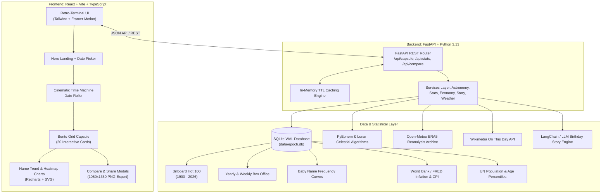

# EPOCH ⏳
> *"Every day has a story. This one's yours."*

**EPOCH** is a full-stack data science time capsule and retro-terminal web application. It asks a visitor for their name and birthdate, then reconstructs an animated, deeply personalized "time capsule" of what planet Earth and the solar system looked like on the day they were born, alongside statistical and biological counters of their life so far.

---

## 🧭 Table of Contents
- [Architecture & Data Pipeline](#-architecture--data-pipeline)
- [Design System](#-design-system)
- [Features](#-features)
- [Tech Stack](#-tech-stack)
- [Quickstart Guide](#-quickstart-guide)
  - [Option A: Local Development](#option-a-local-development)
  - [Option B: Docker Compose](#option-b-docker-compose)
- [Running Unit Tests](#-running-unit-tests)
- [Data Sources & Methodology](#-data-sources--methodology)
- [Future Ideas](#-future-ideas)

---

## 🏛 Architecture & Data Pipeline



---

## 🎨 Design System

EPOCH strictly implements the retro-terminal cyberpunk aesthetic:

### Typography
- **Headlines & Big Numbers**: `Silkscreen` (Google Fonts, uppercase with generous letter-spacing).
- **Body & Microcopy**: `IBM Plex Sans` (400, 500, 600) for high-contrast legibility.

### Color Palette (Dark Mode Only)
| Token | Hex | Usage |
| :--- | :--- | :--- |
| **Background** | `#000000` | Deep obsidian terminal background |
| **Surface** | `#141414` | Rounded cards (16px radius), panels, inputs |
| **Border** | `#001000` | Faint terminal bezel borders |
| **Text** | `#9CFF8C` | Terminal phosphor green for readable body text |
| **Primary** | `#C6FF3D` | Electric chartreuse for main CTA buttons, big metrics |
| **Accent** | `#33FF66` | Neon emerald for glows, hover states, active pulses |

### Micro-Interactions & Textures
- **CRT Scanlines & Dot-Grid**: Faint analog scanline texture overlay (`.scanlines`) and dot matrix grid (`.dot-grid`).
- **Card Hover Glows**: Subtle radial box-shadow glows using `#33FF66` at low opacity.
- **Konami Code Easter Egg**: Press `↑ ↑ ↓ ↓ ← → ← → B A` anywhere to trigger a 5-second rainbow pulse!
- **Birthday Easter Egg**: If your birthday is today, Epoch bursts with confetti and a celebratory banner.

---

## 🌟 Features

### 1. Life Statistics (Pure Computation)
- **Live Seconds Counter**: Real-time ticking counter of seconds alive since birth.
- **Biological Estimates**: Estimated heartbeats (~80 bpm) and breaths (~16 bpm) logged so far.
- **Weekday & Folk Rhyme**: Weekday born with historical rhyme (e.g. *"Tuesday's child is full of grace"*).
- **Next Solar Return**: Countdown in days to your next birthday with weekday and age-year progress ring.
- **Life Milestones**: 10,000th, 15,000th, and 20,000th day milestones with exact dates and unlocked badges.
- **Cosmic Voyage**: Earth orbits completed and distance traveled through space (~30 km/s around the Sun) compared to trips to the Moon.
- **Lunar Phase**: SVG moon phase with illumination percentage and full moons seen.
- **Archetypes**: Western zodiac, Chinese zodiac with 5-element cycle (Wood/Fire/Earth/Metal/Water), and birthstone.
- **Demographics**: *"Older than X% of the world"* based on UN demographic models, with a hopeful life progress bar.

### 2. The World That Day
- **Billboard #1 Hit**: Week's #1 hit on the Billboard charts (with nearest fallback if pre-1958) plus direct YouTube and Spotify search links.
- **Box Office**: Highest-grossing film of that week/season and the biggest movie of the year with trivia.
- **On This Day in History**: Wikimedia Foundation highlights on that exact month and day with year chips and expandable list.
- **Birthday Twins**: Notable historical figures who share your birthday.
- **World Leaders**: US President, UK Prime Minister, and UN Secretary-General in office.
- **Historical Weather**: Temperature and atmospheric condition in chosen city via Open-Meteo archive.
- **Money Machine**: Prices of a movie ticket, gallon of gasoline, loaf of bread, and ounce of gold then vs now, with multi-currency conversion (USD, GBP, EUR, CAD, AUD, JPY, INR, BRL, CNY, MXN, ZAR).
- **World Population**: Human count on Earth when you were born vs today.

### 3. Data Science Extras
- **Birthday Popularity Heatmap**: 366-day calendar heatmap ranking your birth date rarity (e.g. *"Rarer than 68% of dates"*).
- **Name Popularity Trajectory**: Recharts interactive line chart showing your name's popularity curve across the 20th and 21st centuries.
- **Interactive Life Timeline**: Horizontal chronological track plotting personal life milestones alongside momentous world events.
- **Then vs Now Dashboard**: Side-by-side comparison of world population, internet penetration, global life expectancy, and GDP per capita.
- **Birthday Story**: Personalized, warm ~150-word narrative generated on demand with typewriter animation and regeneration button.

### 4. Compare Mode
- Input a friend or partner's name and birthdate:
  - Age difference in days and decimal years.
  - Combined lived days and next joint milestone date (e.g. *"Combined 30,000 days"*).
  - Shared weekday, Western zodiac, and Chinese zodiac alignments.
  - Cosmic distance separation lead.

### 5. Share & Save
- **Downloadable Image Card**: High-resolution 1080x1350 poster exported directly via HTML-to-Image.
- **Shareable URL**: Encodes name and date in the URL without storing any personal data on a server.
- **Copy Summary**: Formatted markdown/plain-text dispatch ready for messages.

---

## 🛠 Tech Stack

- **Backend**: Python 3.13, FastAPI, SQLite (WAL mode), Pydantic v2, Pandas, Ephem, HTTPX, Pytest.
- **Frontend**: React 19, Vite, TypeScript, Tailwind CSS, Framer Motion, Recharts, Lucide Icons, Canvas-Confetti, html-to-image.
- **Deployment**: Docker, Docker Compose, Nginx.

---

## 🚀 Quickstart Guide

### Option A: Local Development

#### 1. Setup Backend
```bash
cd backend
python -m venv venv

# Windows PowerShell:
.\venv\Scripts\Activate.ps1
# macOS / Linux:
# source venv/bin/activate

pip install -r requirements.txt

# Seed SQLite database:
python ../data/ingest/ingest_all.py

# Run FastAPI dev server:
uvicorn app.main:app --reload --port 8000
```
Backend API will be running at `http://localhost:8000`. Docs at `http://localhost:8000/docs`.

#### 2. Setup Frontend
```bash
cd frontend
npm install
npm run dev
```
Open `http://localhost:5173` in your browser.

---

### Option B: Docker Compose

Ensure Docker is running, then run from the root directory:
```bash
docker compose up --build
```
- Frontend: `http://localhost:3000`
- Backend API: `http://localhost:8000`

---

## 🧪 Running Unit Tests

To run the backend test suite (testing astronomical math, leap-year handling, life stats, milestones, zodiac calculations, and API endpoints):

```bash
# In backend directory with venv activated:
pytest app/tests
```

---

## 📚 Data Sources & Methodology

1. **Billboard Hot 100 Archives**: Historical #1 singles compiled from 1958 through present, with nearest-neighbor search for earlier 20th-century hits.
2. **Open-Meteo ERA5 Reanalysis**: Historical global meteorological reanalysis at 0.25° resolution.
3. **Wikimedia "On This Day" API**: Curated historical events, births, and milestones.
4. **UN Population Division**: World Population Prospects demographic estimates and age pyramids.
5. **US Social Security Administration & NCHS**: Multi-decade baby name frequency and 366-day birthday distributions.
6. **World Bank & FRED**: Historical Consumer Price Index (CPI), commodities, and macroeconomic indicators.
7. **PyEphem Astronomical Library**: High-precision lunar ephemeris and heliocentric orbital mechanics.

---

## 🔮 Future Ideas
- **Spotify OAuth Integration**: Generate a personal "Day You Were Born" playlist directly into your Spotify account.
- **Astronomy Sky Map**: Interactive Three.js/WebGL night sky showing planetary constellations visible on that night from your birth latitude.
- **Newspaper Front Pages**: Archive image integration pulling front-page scans of historical newspapers on that morning.
- **Audio Synthesizer**: Web Audio API retro-terminal chimes and tape-deck sound effects when rewinding time.
